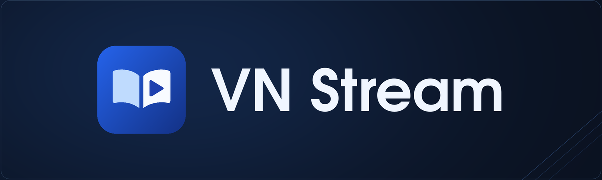

<div align="center">
  <h1>VN Stream</h1>
  <p>Stream visual novels in your browser, wherever you are</p>
  <p><a href="README.md">English</a> · <a href="README_ZH.md">简体中文</a></p>
  <p>
    <a href="https://github.com/Mr-Righter/vn-stream/releases/tag/v1.0.0"></a>
    <a href="https://github.com/Mr-Righter/vn-stream/pkgs/container/vn-stream"></a>
    <a href="#quick-start"></a>
    <a href="LICENSE"></a>
  </p>
  <p>
    <a href="#supported-game-engines">Supported game engines</a> ·
    <a href="#features">Features</a> ·
    <a href="#quick-start">Quick start</a> ·
    <a href="#running-games-and-tuning-streams">Running games and tuning streams</a>
  </p>
  
</div>

VN Stream is a self-hosted visual novel library for Ren'Py, ONScripter, and Kirikiri. After you import a game, VN Stream runs it on your host and streams its video and audio to your browser.

## Supported game engines

| Engine     | Bundled runtimes and sources                                                                                                                                                                                                            | Default and compatibility                                                                                                                                                                      |
| ---------- | --------------------------------------------------------------------------------------------------------------------------------------------------------------------------------------------------------------------------------------- | ---------------------------------------------------------------------------------------------------------------------------------------------------------------------------------------------- |
| Ren'Py     | Official SDKs 7.5.3, 7.8.2, 8.0.3, 8.1.3, 8.2.3, 8.3.2, 8.3.7, 8.4.1, and 8.5.3. [Official releases](https://www.renpy.org/release_list.html)                                                                                           | Prefers the game's detected version, then the closest newer installed SDK in the same major version.                                                                                           |
| ONScripter | [Yuri 0.7.7](https://github.com/YuriSizuku/OnscripterYuri), [Jh 0.7.3](https://github.com/chf2000/ONScripter-Jh), [zero 0.9.10-dev](https://github.com/zeromake/ONScripter-zero), and [NEW](https://github.com/timftw21/ONScripter-NEW) | Defaults to Yuri. zero is for GBK or Shift-JIS projects and requires AVX2. NEW requires a UTF-8 text entry point (`0.txt` or `00.txt`) and a game-provided `fonts/default.ttf`.                |
| Kirikiri   | [krkr-rs](https://github.com/wqlouis/krkr-rs) and [KrKr2-Next](https://github.com/reAAAq/KrKr2-Next)                                                                                                                                    | Defaults to krkr-rs. Compatibility depends on the game's plugins and archive format. The bundled KrKr2-Next currently lacks support for projects that depend on `Motion.D3DAdaptor` or Live2D. |

## Features

| Feature                     | Description                                                                                                                                                                                                                            | Supported engines                                                   |
| --------------------------- | -------------------------------------------------------------------------------------------------------------------------------------------------------------------------------------------------------------------------------------- | ------------------------------------------------------------------- |
| Save management and editing | Import, download, back up, and restore saves. Supports local signing, editing simple variables, and migrating saves between projects.                                                                                                  | Ren'Py                                                              |
| Media library               | Browse, preview, and download supported images, audio, and video.                                                                                                                                                                      | Ren'Py, ONScripter, Kirikiri                                        |
| Game uploads                | Upload the **complete root folder of a single game**, such as a Ren'Py project containing `game/`. Supported archives include `.zip`, `.7z`, `.rar`, `.tar`, `.tar.gz`, `.tar.bz2`, and `.tar.xz`. Compatible APKs are also supported. | Ren'Py, ONScripter, Kirikiri (APK imports are available for Ren'Py) |

## Quick start

Docker Compose v2 is required. The image targets `linux/amd64`. Use Docker Engine on Linux and Docker Desktop with Linux containers on macOS and Windows. Enable AMD64 emulation on Apple Silicon. [Docker Desktop settings](https://docs.docker.com/desktop/settings-and-maintenance/settings/)

### 1. Prepare the games directory and Compose file

**Linux and macOS**

```sh
mkdir -p vn-stream/games
cd vn-stream
chmod 777 games
curl -fL -o compose.yaml https://raw.githubusercontent.com/Mr-Righter/vn-stream/HEAD/compose.yaml
```

**Windows PowerShell**

```powershell
New-Item -ItemType Directory -Force -Path vn-stream, vn-stream/games
Set-Location vn-stream
curl.exe -fL -o compose.yaml https://raw.githubusercontent.com/Mr-Righter/vn-stream/HEAD/compose.yaml
```

Set `PASSWORD` before starting. You can also change `CUSTOM_USER`, the host port, or `source` to use an existing games directory.

```yaml
services:
  vn-stream:
    image: ghcr.io/mr-righter/vn-stream:v1.0.0
    platform: linux/amd64
    restart: unless-stopped
    shm_size: 1gb
    ports:
      - "127.0.0.1:8443:3000"
    environment:
      CUSTOM_USER: player
      PASSWORD: "change-this-password"
    volumes:
      - type: bind
        source: ./games
        target: /games
        bind:
          create_host_path: false
      - vn-stream-data:/data
      - vn-stream-config:/config

volumes:
  vn-stream-data:
    name: vn-stream-data
  vn-stream-config:
    name: vn-stream-config
```

### 2. Start VN Stream and open the library

```sh
docker compose up -d
```

On the Docker host, open <http://localhost:8443/library/> and sign in. Use **Import** to add games. You can also put extracted projects under `renpy/`, `onscripter/`, or `kirikiri/` in `games/`, then refresh the library.

<details>
<summary>Full-screen play on iOS</summary>

1. Open the game library's HTTPS address in Safari on your iPhone or iPad.
2. Tap **Share** → **Add to Home Screen**. If you see **Open as Web App**, turn it on, then tap **Add**. [Apple guide](https://support.apple.com/guide/iphone/open-as-web-app-iphea86e5236/27/ios/27)
3. Open **VN Stream** from your Home Screen and start a game. The web app hides Safari's address bar and toolbar.

</details>

## Running games and tuning streams

**If a game won't open**, choose another runtime for the same engine on that game's details page. Check that the game starts and can save and load progress. ONScripter animation timing may vary by game and runtime.

**If playback stutters or the connection is slow**, open **Video Settings** and the stats panel in the Selkies sidebar. Adjust one setting at a time and check the result.

| Setting             | How to adjust it                                                                                                                                                                                                                                                                                 |
| ------------------- | ------------------------------------------------------------------------------------------------------------------------------------------------------------------------------------------------------------------------------------------------------------------------------------------------ |
| Frame rate          | Start at 30 FPS. If playback still stutters, try 24 or 20 FPS to reduce the number of frames encoded, transmitted, and decoded each second.                                                                                                                                                      |
| Video CRF           | In CRF mode, try raising 25 gradually to 28–32. Higher values usually use less bandwidth and reduce image quality. In CBR mode, lower the video bitrate.                                                                                                                                         |
| Encoder and decoder | If you see a black screen or dropped frames, try H.264 if your browser supports it. The encoder sets the video format sent by the server. The browser chooses how to decode it based on your device. Check the **Decoder** entry in the stats panel to see whether it uses hardware or software. |

[Selkies](https://github.com/selkies-project/selkies) · [Web client settings](https://docs.linuxserver.io/selkies/user-guide/web-client/) · [Streaming troubleshooting](https://docs.linuxserver.io/selkies/user-guide/troubleshooting/)

## License

[MIT License](LICENSE)
